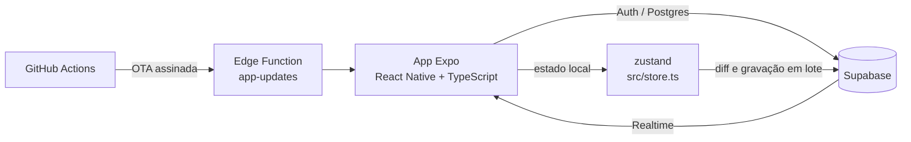

<div align="center">


# Vaia Aí

**Aplicativo para organizar o futebol amador: grupos, jogos, times, placar, ranking e financeiro.**

[](https://github.com/rafablauth1/Chega-A-/actions/workflows/ci.yml)


</div>

---

## Visão geral

O Vaia Aí reúne, num único app, o que o organizador da pelada costuma controlar em planilha e grupo de mensagem:
lista de presença, sorteio dos times, placar, notas, ranking e caixa. Os dados ficam na nuvem e são sincronizados
em tempo real entre os celulares do grupo, com permissões por papel (dono, administrador e jogador).

Além do grupo fechado, o app conecta quem joga bola na mesma região: comunidades com vários times, vagas abertas,
descoberta de jogadores próximos e chat.

## Funcionalidades

| Área | O que faz |
|---|---|
| **Jogos** | Lista de presença com lista de espera automática; o próprio jogador confirma ou desiste; horário da quadra; jogos do clube e avulsos |
| **Times** | Sorteio equilibrado por nota, posição e goleiro, ou escalação manual no campinho |
| **Partida ao vivo** | Cronômetro, gols, assistências e gol contra; um marcador por jogo registra o placar para todos |
| **Avaliação** | Nota pós-jogo de 0 a 10 no estilo Cartola, craque do jogo, seleção da rodada e súmula |
| **Ranking** | Artilharia, assistências, presença, nota e vitórias por mês, ano ou geral, inclusive somando todos os clubes |
| **Perfil de atleta** | Carreira consolidada, card no estilo FIFA, conquistas, fotos e time do coração |
| **Financeiro** | Mensalidades, avulsos, despesas e saldo do clube, com Pix copia e cola e QR Code |
| **Comunidade** | Comunidades (empresa, escola, condomínio) com vários times, vagas abertas ("Falta gente!"), descoberta de jogadores próximos ("Bora") e chat em tempo real |
| **Conta e privacidade** | Login por e-mail, senha com regras fortes, exclusão de conta, denúncia e bloqueio, política de privacidade e termos de uso (LGPD) |
| **Atualizações** | Atualizações OTA assinadas e aviso de nova versão do APK, com download e instalação dentro do app |

## Arquitetura



- **Segurança por RLS**: toda tabela tem Row Level Security; dados pessoais de terceiros só por funções dedicadas.
  Detalhes em [SEGURANCA.md](SEGURANCA.md).
- **Modo local**: sem as variáveis do Supabase, o app funciona apenas no aparelho, sem login.
- **Monitoramento**: erros reportados ao Sentry sem dados pessoais.

## Requisitos

- Node.js 22 ou superior
- Expo Go (para testar no celular) ou um development build
- Projeto Supabase (opcional, para o modo nuvem)

## Como rodar

```bash
npm install
cp .env.example .env     # preencha as variáveis do Supabase (opcional)
npx expo start           # "a" Android, "i" iOS, "w" navegador
```

No navegador, em modo de desenvolvimento, `http://localhost:8081/?demo=1` carrega um grupo de exemplo com 20 jogadores.

| Variável | Uso |
|---|---|
| `EXPO_PUBLIC_SUPABASE_URL` | URL do projeto Supabase |
| `EXPO_PUBLIC_SUPABASE_KEY` | Chave *publishable* (pública por natureza; o acesso é controlado pelo RLS) |

## Qualidade

```bash
npm run check    # tipos, ESLint, migrações SQL, auditoria do banco e varredura de segredos
```

O mesmo conjunto roda a cada envio para `main` ([ci.yml](.github/workflows/ci.yml)), junto de uma exportação do pacote
Android. Um hook de pre-commit bloqueia chaves e tokens antes de entrarem no repositório.

## Distribuição

| Canal | Como funciona |
|---|---|
| **APK** | Publicado em [Releases](https://github.com/rafablauth1/Chega-A-/releases); o app lê `release/android.json` e oferece a atualização |
| **OTA** | Mudanças só de JavaScript são publicadas pelo workflow *Publicar atualização OTA* (execução manual), assinadas com chave própria |
| **Play Store** | Em preparação: ver [ROADMAP.md](ROADMAP.md) |

O passo a passo de build e lançamento está em [AGENTS.md](AGENTS.md).

## Estrutura do projeto

```
src/
  app/              telas (Expo Router: cada arquivo é uma rota)
    (tabs)/         Jogos, Clube, Bora e Ranking
  components/       UI reutilizável: campinho, cards, placar, Pix
  utils/            sorteio, notas, estatísticas, Pix, lembretes, atualização do APK
  lib/              cliente Supabase, armazenamento seguro, Sentry
  store.ts          estado global (zustand), sincronizado por cloud.ts
supabase/
  schema.sql        esquema base
  migrations/       migrações numeradas, com RLS em todas as tabelas
  functions/        Edge Function que serve as atualizações OTA
scripts/            verificações (SQL, banco, segredos) e publicação de OTA e releases
plugins/            config plugins do Expo (assinatura de release, instalador de APK)
docs/               páginas legais: privacidade, termos e exclusão de conta
release/            manifesto da versão Android distribuída fora da loja
updates/            pacotes OTA gerados pelo workflow
```

## Documentação

| Documento | Conteúdo |
|---|---|
| [ROADMAP.md](ROADMAP.md) | O que já foi feito e as próximas fases |
| [SEGURANCA.md](SEGURANCA.md) | Mapa dos dados, RLS, senhas, chaves e LGPD |
| [AUDITORIA.md](AUDITORIA.md) | Auditoria técnica e riscos conhecidos |
| [TAREFAS_DO_DONO.md](TAREFAS_DO_DONO.md) | Configurações que dependem do responsável pelo projeto |
| [AGENTS.md](AGENTS.md) | Contexto técnico, build, assinatura e lançamento |

## Stack

| Camada | Tecnologia |
|---|---|
| App | Expo SDK 57, React Native 0.86, Expo Router, TypeScript |
| Estado | zustand |
| Backend | Supabase (Auth, Postgres com RLS, Realtime, Edge Functions) |
| Atualizações | expo-updates com assinatura própria, GitHub Releases |
| Observabilidade | Sentry |
| CI | GitHub Actions |
